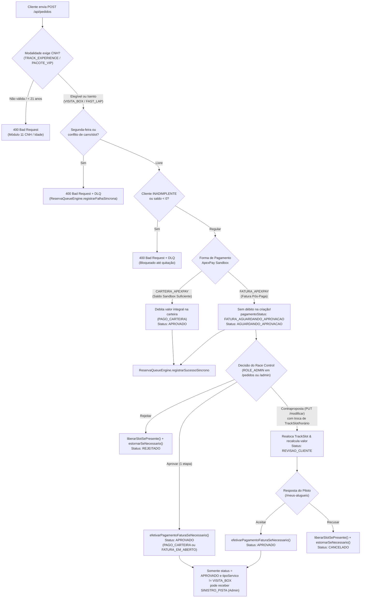

# Fluxo do Sistema — Apex Track Experience & ApexPay Gateway Sandbox

> Arquitetura atualizada após a unificação de papéis, remoção de atores legados (`EMPRESA` e `BANCO`) e reposicionamento do ApexPay como Gateway Financeiro Simulado (Sandbox) da plataforma.

---

## 1. Visão Geral e Atores Ativos

O sistema opera com **apenas 2 papéis ativos**, refletindo a operação real de um clube/autódromo Arrive & Drive:

1. **`ROLE_CLIENTE` (Piloto / Cliente):**
   - Cadastra-se em `/cadastro` (`AuthPage.tsx`, fluxo em 3 etapas: *Identificação* → *Documentos & CNH* → *Segurança & Acesso*), sempre travado em `role: 'CLIENTE'`.
   - Consulta os 8 circuitos internacionais (`/pistas`), frota de supercarros (`/cars`, `/cars/:id`), agenda sessões (`SessionBookingModal.tsx`), acompanha status e responde contrapropostas (`/meus-alugueis`), e gerencia saldo simulado, extrato e CNH (`/apexpay`).
2. **`ROLE_ADMIN` (Apex Race Control):**
   - Conta inicializada pelo `DataInitializer.java` (`admin@apex.com` / `admin123`), com exclusão e migração automática de dados legados (`empresa@rentcars.com`, `banco@rentcars.com`).
   - Acesso completo via `@Secured("ROLE_ADMIN")` em:
     - `/admin` (`AdminDashboardPage.tsx`): KPIs financeiros, pilotos regulares e inadimplentes, aplicação de juros diários (`0,1%`), ajuste manual de saldo, lançamento de sinistros (`SINISTRO_PISTA`) e saúde da fila (`ReservaQueueEngine`).
     - `/pedidos` (`PedidosPage.tsx`): homologação em 1 etapa (`AGUARDANDO_APROVACAO` → `APROVADO` ou `REJEITADO`) e contrapropostas com troca real de `TrackSlot`.
     - `/frota` (`FrotaPage.tsx`): CRUD completo de veículos, vinculação aos 8 autódromos (`circuitosDisponiveis`) e flag operacional `ativoBox`.

> Rotas e componentes legados (`AnalisesPage.tsx`, `ROLE_EMPRESA`, `ROLE_BANCO`, `PENDENTE_EMPRESA`, `PENDENTE_BANCO`) foram removidos. `/analises` redireciona para `/admin`.

---

## 2. Diagrama de Fluxo Unificado de Reserva e Pagamento

---

## 3. Papel do ApexPay — Gateway Financeiro Simulado (Sandbox)

Como a plataforma é demonstrativa e não processa cartões ou Pix bancários reais, o **ApexPay** funciona como um **gateway financeiro simulado interno**:

- **Recarga Instantânea (`POST /api/apexpay/deposito`):** credita saldo fictício na carteira do piloto para testar reservas, quitação de dívidas e estornos.
- **Zero Tiers ou Descontos Artificiais:** `Usuario.getFatorDesconto()` retorna `0` (`CONTA_VERIFICADA`) e toda reserva é cobrada pelo valor integral da modalidade + taxa de turno do `TrackSlot`.
- **Dois Modos de Checkout Transparentes:**
  - `CARTEIRA_APEXPAY`: valida saldo disponível, debita imediatamente (`PAGO_CARTEIRA`) e confirma o agendamento em **Green Flag (`APROVADO`)**.
  - `FATURA_APEXPAY`: submete o pedido para homologação em 1 etapa (`AGUARDANDO_APROVACAO` / `FATURA_AGUARDANDO_APROVACAO`). O débito só é efetivado quando o Race Control aprova (ou quando o piloto aceita uma contraproposta). Se a carteira não tiver cobertura no aceite, o saldo torna-se negativo (`FATURA_EM_ABERTO` + `INADIMPLENTE`).
- **Controle de Inadimplência & Juros (`0,1%` ao dia):** clientes inadimplentes ficam bloqueados para novas reservas até quitarem o saldo devedor via depósito no Sandbox; o Race Control pode aplicar juros diários pelo painel `/admin`.

---

## 4. Resumo dos 8 Gaps Arquiteturais Resolvidos

| Gap | Problema Original | Solução Implementada |
|---|---|---|
| **Gap 1** | Atores legados (`EMPRESA`, `BANCO`), `/analises` e dupla aprovação `PENDENTE_EMPRESA -> PENDENTE_BANCO` | Expurgo de `empresa@rentcars.com` / `banco@rentcars.com` no `DataInitializer`, controllers travados em `@Secured("ROLE_ADMIN")`, máquina de estados unificada em `AGUARDANDO_APROVACAO -> APROVADO`, remoção de `AnalisesPage.tsx` e rotas legadas. |
| **Gap 2** | `FATURA_APEXPAY` debitava/negativava o cliente na criação antes mesmo da análise | Criação mantém `FATURA_AGUARDANDO_APROVACAO` + `AGUARDANDO_APROVACAO` sem débito; cobrança efetivada via `efetivarPagamentoFaturaSeNecessario` apenas na aprovação do `ADMIN` ou aceite da contraproposta pelo cliente. |
| **Gap 3** | Cadastro Etapa 3 herdava formulário de renda mensal/empregadora do fluxo bancário e não coletava CNH | `authSchema.ts` e `AuthPage.tsx` atualizados: Etapa 2 (`Documentos & CNH`) inclui CNH e data de nascimento opcionais; Etapa 3 (`Segurança & Acesso`) removeu `rendimentos` e exibe ativação da carteira Sandbox ApexPay. |
| **Gap 4** | Contraproposta alterava apenas timestamps sem atualizar `TrackSlot`, e aceite ia para `PENDENTE_BANCO` | `PedidoFacade.modificarPedidoAgente` suporta troca de `TrackSlot` com liberação/ocupação de vagas; `responderContrapropostaCliente` transiciona diretamente para `APROVADO`; `PedidosPage.tsx` e `MeusAlugueisPage.tsx` integrados ao fluxo. |
| **Gap 5** | Cadastro de veículo em `/frota` não expunha `circuitosDisponiveis` nem flag operacional `ativoBox` | `AutomovelFacade.java` sincroniza os 8 circuitos e `ativoBox`; `carSchema.ts` e `FrotaPage.tsx` oferecem seleção múltipla dos 8 autódromos e toggle `Ativo no Box` / `Fora de Operação`. |
| **Gap 6** | `ReservaQueueEngine` só registrava métricas do endpoint `/async`, deixando `/admin` zerado para uso síncrono | `PedidoController.criar` aciona `registrarSucessoSincrono` e `registrarFalhaSincrona` (DLQ) em `ReservaQueueEngine.java`, refletindo o tráfego real em `/admin`. |
| **Gap 7** | `registrarSinistro` aceitava lançamento em pedidos pendentes, cancelados ou `VISITA_BOX` | `AdminDashboardFacade.registrarSinistro` bloqueia `status != "APROVADO"` e `tipoServico == "VISITA_BOX"`; `AdminDashboardPage.tsx` oculta o botão `Lançar Sinistro` fora dessas condições. |
| **Gap 8** | Navegação administrativa espalhada entre `/admin`, `/pedidos`, `/frota` e `/analises` | Consolidação exclusiva de `ROLE_ADMIN` em `/admin`, `/pedidos` e `/frota` (`Header.tsx`, `App.tsx`, `AdminDashboardPage.tsx`), removendo `/analises` e atalhos de `EMPRESA`/`BANCO`. |
